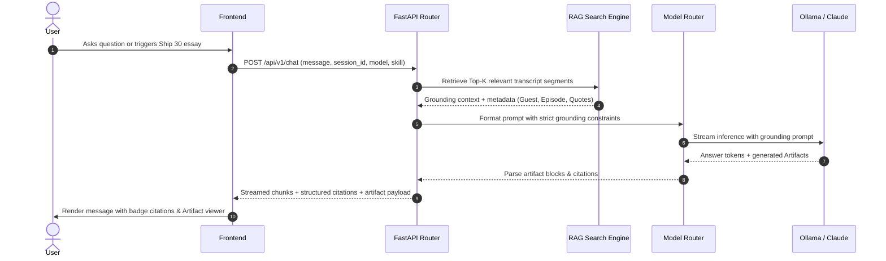

# Architecture Specification
## The Lenny Growth Assistant
**Author / Role:** Forward Deployed Engineer (FDE)  
**System Version:** v1.0.0  
**Target Topology:** Local Evaluation (Ollama) & Cloud-Ready Deployment  

---

## 1. System Overview & Component Boundaries

The Lenny Growth Assistant is organized as a decoupled, multi-tiered architecture:

```
┌────────────────────────────────────────────────────────────────────────┐
│                   Frontend (React + Vite + Modern CSS)                 │
│  ┌───────────────────────┐  ┌────────────────────────────────────────┐ │
│  │   Chat Conversation   │  │    Sandboxed Artifact Viewer           │ │
│  │  - Session History    │  │    - Markdown Rendered Tabs            │ │
│  │  - Model Toggle UI    │  │    - HTML/CSS Sandbox (iframe + CSP)   │ │
│  │  - Citations Drawer   │  │    - Code Copy & Export                │ │
│  └───────────┬───────────┘  └───────────────────▲────────────────────┘ │
└──────────────┼──────────────────────────────────┼──────────────────────┘
               │ HTTP / JSON Streaming            │
┌──────────────▼──────────────────────────────────┴──────────────────────┐
│                   Backend API (FastAPI / Python 3.12)                  │
│                                                                        │
│  ┌─────────────────────┐  ┌────────────────────┐  ┌─────────────────┐  │
│  │ /api/v1/sessions    │  │ /api/v1/chat       │  │ /api/v1/health  │  │
│  │ Session Controller  │  │ Agent & Skill Exec │  │ Diagnostics     │  │
│  └──────────┬──────────┘  └─────────┬──────────┘  └─────────────────┘  │
│             │                       │                                  │
│  ┌──────────▼──────────┐  ┌─────────▼──────────┐  ┌─────────────────┐  │
│  │ Persistence Layer   │  │ RAG & Search Engine│  │ Model Router    │  │
│  │ PostgreSQL / SQLite │  │ - BM25 & Semantic  │  │ - Ollama (Local)│  │
│  │ SQLModel / SQLAlchemy│ │ - Topic Index Match │  │ - Claude/OpenAI │  │
│  └─────────────────────┘  │ - Transcript Cache │  └─────────────────┘  │
│                           └────────────────────┘                       │
└────────────────────────────────────────────────────────────────────────┘
```

---

## 2. Ingestion & Retrieval Flow (RAG Pipeline — Phase 1B Verified)

### 2.1 Production Knowledge Corpus & Organization
- **Transcript Dataset**: 303 complete podcast episodes located in `data/transcripts/episodes/<slug>/transcript.md`.
- **Topical Taxonomy**: 89 curated topic index files in `data/transcripts/index/<topic>.md`.
- **Document Model**:
  - Structured YAML frontmatter parsing (`title`, `description`, `date`, `youtube_url`, `cover_image`).
  - Regex-based conversational turn parsing with precise `HH:MM:SS` or `MM:SS` timestamps.
  - Verification: 62,272 distinct dialogue turns parsed in 0.54s across the full corpus.

### 2.2 Conversational Chunking Strategy
- **Turn-Preserving Window**: Groups adjacent conversational turns into semantic passages (target: 180 words, overlap: 35 words).
- **Speaker Continuity**: Preserves speaker names (`Lenny Rachitsky: ...`, `Guest: ...`) to enable verbatim citation attribution.
- **Timestamp Propagation**: Computes start/end seconds and synthesizes verified YouTube deep-link URLs (`&t={s}s`).
- **Total Chunks**: 32,209 chunks generated across all 303 episodes in 1.06s.

### 2.3 Hybrid Retrieval Engine Architecture
Combines three complementary signals using Reciprocal Rank Fusion (RRF):
1. **Dense Semantic Retrieval**:
   - Model: `BAAI/bge-small-en-v1.5` via FastEmbed (ONNX runtime on CPU, 384-dimensional float32 vectors).
   - In-memory normalized matrix with cosine similarity computed via matrix-vector dot product ($<2$ms per query).
2. **Lexical Keyword Retrieval (BM25)**:
   - `BM25Okapi` with tokenization pattern `[a-zA-Z0-9_\-\.\']+` and `epsilon=0.25` smoothing.
   - Guaranteed exact matching for guest names, proper nouns, and specific PM methodologies.
3. **Curated Topic Index Matching**:
   - Bidirectional episode-to-topic graph constructed across 89 taxonomy markdown files.
   - Matches query concepts to topic indexes and applies candidate rank boosting.
4. **Reciprocal Rank Fusion (RRF)**:
   - Fusion formula: $RRF(d) = \sum_{m \in \{dense, lex, topic\}} \frac{1}{60 + rank_m(d)}$.
   - Adjacent turn deduplication within the same episode to prevent repetitive excerpts.

### 2.4 Grounding & Failure Classification
To prevent hallucination and false claims of absence:
- **Query Term Coverage**: Measures non-stopword query token overlap against candidate passages.
- **Decision Engine**:
  - `RELEVANT_EVIDENCE_FOUND`: Triggered when semantic similarity $\ge 0.70$ (high semantic agreement), or balanced hybrid match ($\ge 0.62$ semantic + $\ge 40\%$ term coverage), or strong entity match ($\ge 60\%$ coverage + lexical $\ge 15.0$).
  - `INSUFFICIENT_EVIDENCE`: Explicitly returned for ungrounded or off-topic queries (e.g., quantum particle physics) without hallucinating citations.
- **Index State Signals**: Explicitly surfaces `empty`, `unindexed`, `indexing`, `ready`, and `error`.

### 2.5 Disk Persistence & Performance
- **Storage Location**: `data/indices/` (excluded from git via `.gitignore`).
  - `embeddings.npy`: 49.5 MB normalized float32 matrix `(32209, 384)`.
  - `chunks.json`: 57.4 MB metadata and verbatim excerpts.
  - `manifest.json`: State tracking and SHA-256 file hashes for incremental updates.
- **Total Index Size**: 106.94 MB.
- **Startup Load Time**: $< 2.0$s from cold disk into memory.
- **Query Latency**: $\approx 25$–$45$ms per hybrid query.

### 2.2 Grounding & Citation Flow


---

## 3. Database Schema (PostgreSQL)

```sql
-- Sessions table
CREATE TABLE sessions (
    id UUID PRIMARY KEY DEFAULT gen_random_uuid(),
    title VARCHAR(255) NOT NULL DEFAULT 'New Conversation',
    model_provider VARCHAR(50) NOT NULL DEFAULT 'ollama',
    model_name VARCHAR(100) NOT NULL DEFAULT 'llama3.2',
    created_at TIMESTAMP WITH TIME ZONE DEFAULT NOW(),
    updated_at TIMESTAMP WITH TIME ZONE DEFAULT NOW()
);

-- Messages table
CREATE TABLE messages (
    id UUID PRIMARY KEY DEFAULT gen_random_uuid(),
    session_id UUID NOT NULL REFERENCES sessions(id) ON DELETE CASCADE,
    role VARCHAR(20) NOT NULL CHECK (role IN ('user', 'assistant', 'system')),
    content TEXT NOT NULL,
    citations JSONB DEFAULT '[]'::jsonb,
    metadata JSONB DEFAULT '{}'::jsonb,
    created_at TIMESTAMP WITH TIME ZONE DEFAULT NOW()
);

-- Artifacts table
CREATE TABLE artifacts (
    id UUID PRIMARY KEY DEFAULT gen_random_uuid(),
    session_id UUID NOT NULL REFERENCES sessions(id) ON DELETE CASCADE,
    message_id UUID REFERENCES messages(id) ON DELETE SET NULL,
    title VARCHAR(255) NOT NULL,
    artifact_type VARCHAR(50) NOT NULL CHECK (artifact_type IN ('markdown', 'html', 'svg', 'code')),
    content TEXT NOT NULL,
    version INTEGER NOT NULL DEFAULT 1,
    created_at TIMESTAMP WITH TIME ZONE DEFAULT NOW()
);

-- Indexing for fast retrieval
CREATE INDEX idx_messages_session ON messages(session_id);
CREATE INDEX idx_artifacts_session ON artifacts(session_id);
```

---

## 4. Model Toggle Architecture & Router

```python
class LLMProvider(ABC):
    @abstractmethod
    async def generate_response(self, prompt: str, system_prompt: str, stream: bool = False):
        pass

class OllamaProvider(LLMProvider):
    def __init__(self, base_url: str = "http://localhost:11434", model: str = "llama3.2"):
        self.base_url = base_url
        self.model = model

class AnthropicProvider(LLMProvider):
    def __init__(self, api_key: str, model: str = "claude-sonnet-4-6"):
        self.client = AsyncAnthropic(api_key=api_key)
        self.model = model
```

- Dynamic switching handled in memory per request based on `model_provider` parameter.
- Health monitor queries `/api/v1/health` to confirm Ollama daemon liveness before routing.

---

## 5. Security & Untrusted Artifact Sandboxing

Generated artifacts can contain user-prompted or LLM-generated HTML/CSS/JavaScript. To guarantee zero data leakage and prevent Cross-Site Scripting (XSS):
1. **Isolated Iframe**: Artifacts with HTML/CSS are rendered inside `<iframe sandbox="" srcdoc="...">` (strictly empty sandbox attribute with zero permissive tokens).
2. **Restricted Privileges**: 
   - `allow-scripts` is **omitted** (no JavaScript execution permitted).
   - `allow-same-origin` is **omitted** to ensure the iframe cannot access the host application's DOM, cookies, session storage, or API tokens.
   - `allow-forms`, `allow-top-navigation`, and `allow-modals` are strictly blocked.
3. **Content Security Policy (CSP)**:
   - `<meta http-equiv="Content-Security-Policy" content="default-src 'none'; style-src 'unsafe-inline'; img-src data:; form-action 'none';">`.
   - Restricts external network calls (`default-src 'none'`), disallows form submissions (`form-action 'none'`), and blocks tracking pixels.

---

## 6. Deployment Topology & Operational Readiness
- **Option A (Docker Compose)**: Single command `docker compose up --build` launches PostgreSQL, FastAPI backend, and built React frontend.
- **Option B (Local Dev Script)**: `run_dev.ps1` checks for Python 3.12 and Ollama, verifies daemon status, initializes the database, and launches backend + frontend dev servers.
- **Environment Configuration**: Explicit `.env.example` with documented keys (`DATABASE_URL`, `OLLAMA_BASE_URL`, `ANTHROPIC_API_KEY`, `OPENAI_API_KEY`).

---

## 7. AI Providers, Agent Orchestration & Tool Sandboxing (Phase 1C)

### 7.1 Provider Hierarchy & Model Routing
The assistant supports dynamic, runtime-swappable model routing across local and cloud providers:

| Provider | Model Identifier | Type | Memory Footprint | Default / Role |
| :--- | :--- | :--- | :--- | :--- |
| **Ollama** | `llama3.2` | Local | ~2.0 GB VRAM/RAM | **Default** high-quality reasoning provider |
| **Ollama** | `qwen2.5:1.5b` | Local | ~986 MB VRAM/RAM | Lightweight alternative for constrained environments |
| **OpenAI** | `gpt-4o` | Cloud | External API | Optional flagship cloud model (requires `OPENAI_API_KEY`) |
| **OpenAI** | `gpt-4o-mini` | Cloud | External API | Optional fast cloud model (requires `OPENAI_API_KEY`) |
| **Anthropic** | `claude-sonnet-4-6` | Cloud | External API | Optional flagship cloud model (requires `ANTHROPIC_API_KEY`, configurable via `ANTHROPIC_DEFAULT_MODEL`) |
| **Anthropic** | `claude-haiku-4-5`  | Cloud | External API | Optional fast lightweight cloud model (requires `ANTHROPIC_API_KEY`) |
| **Groq**      | `openai/gpt-oss-20b` | Cloud | External API (Free Tier) | Default high-speed open reasoning model on Groq LPU (requires `GROQ_API_KEY`, configurable via `GROQ_MODEL`) |
| **Groq**      | `llama-3.3-70b-versatile` | Cloud | External API (Free Tier) | Optional high-intelligence cloud model on Groq LPU (requires `GROQ_API_KEY`) |

### 7.2 Graceful Cloud Fallback & Zero-Paid-Credential Guarantee
1. **Local Independence**: No paid cloud API key is required to develop, run, test, or evaluate the application. Local Ollama (`llama3.2` and `qwen2.5:1.5b`) is fully autonomous.
2. **Graceful Cloud Handling**: When `OPENAI_API_KEY`, `ANTHROPIC_API_KEY`, or `GROQ_API_KEY` is not configured, the system:
   - Does **not** throw 500 errors, crash, or block application startup.
   - Accurately reports `is_configured: false` via `GET /api/v1/providers/status`.
   - Automatically and transparently routes inquiries to local Ollama (`llama3.2`) with a clear diagnostic notice:  
     `"[Notice: <Provider> Cloud provider is unconfigured (<KEY> not set). Automatically routed to local Ollama (llama3.2). Live cloud testing marked as pending.]"`
   - Complete cloud integration code is implemented and verified with mock test suites (`tests/test_cloud_providers_audit.py` and `tests/test_groq_provider.py`); live cloud testing is marked as pending.
   - All cloud client requests enforce strict 60-second timeouts (`timeout=60.0`) preventing hanging on external network disruptions.

### 7.3 Sandboxed Agent Orchestration (`AgentOrchestrator`)
For multi-step reasoning, tool execution, and deliverable creation, the system provides an agentic tool-calling engine:
- **Native Tool Schemas**: Implements standard OpenAI / Ollama function calling specifications (`AGENT_TOOL_SCHEMAS`).
- **Whitelisted Domain Tools**:
  - `search_podcast_transcripts(query: str, top_k: int = 5, guest_filter: Optional[str] = None)`
  - `get_topic_insights(topic_name: str)`
  - `generate_sandboxed_artifact(title: str, artifact_type: str, content: str)`
- **Strict Security Sandboxing Policy**:
  - In accordance with architectural security rules, all host filesystem tools (`read_file`, `write_file`, `delete_file`, `list_dir`) and shell execution tools (`exec`, `bash`, `cmd`, `eval`, `powershell`) are **strictly disabled and omitted** in user-facing sessions.
  - Attempting to invoke any unauthorized tool immediately triggers `SecuritySandboxingViolation` and is blocked.

### 7.4 Official Pi Coding Agent SDK Service & Sandboxing Architecture
- **Official SDK Implementation**: The system integrates the official `@earendil-works/pi-coding-agent@1.1.0` in a dedicated Node.js microservice (`agent_service/pi_agent.mjs`).
- **Tool Sandboxing Compliance**:
  - `noTools: "builtin"` disables all built-in host shell (`bash`, `powershell`) and filesystem mutating tools (`read`, `write`, `edit`, `ls`, `grep`, `find`).
  - Explicit allowlist enables domain-specific retrieval tools: `search_podcast_transcripts` and `generate_sandboxed_artifact`.
  - TypeBox parameter schemas validate all tool invocation arguments before dispatching calls to the FastAPI backend.
- **Dual Runtime Architecture**:
  1. *High-Performance Daemon (`agent_service/server.mjs` on port 8001)*: Maintains a warm Node runtime and model provider cache, serving agent chat completions with sub-200ms overhead.
  2. *Subprocess Runner (`agent_service/runner.mjs`)*: Provides zero-daemon standalone CLI execution via Python `subprocess` fallback.
- **Resource Lifecycle**: Guaranteed session cleanup via `session.dispose()` in `finally` blocks, preventing memory leaks and orphaned processes.

---

## 8. Specialized Writing Engine (Ship 30 for 30)

Implemented in `app.services.ship30_skill.Ship30SkillService` and exposed via `POST /api/v1/skills/ship30` and `POST /api/v1/chat` (`skill="ship30"`):
- **Core Architecture**: Encodes the 8 digital writing principles established by Dickie Bush & Nicolas Cole:
  1. *The Irresistible Headline*: Promises a specific, compelling outcome for product leaders.
  2. *The 1-3-1 Cadence Hook*: 1 punchy opener, 3 context/tension sentences, 1 definitive transition.
  3. *Clear Narrative Progression*: Problem -> Epiphany -> Framework -> Execution.
  4. *Short, Breathable Paragraphs*: 1-3 sentences max for high skimmability.
  5. *Structured Sections & Subheadings*: Guides scanning readers.
  6. *Selective Bold Lead-Ins*: **The Trap:**, **The Principle:**, **The Playbook:**, **The Action:**.
  7. *Scannable Pillars with Guest Grounding*: Core pillars with direct transcript attribution.
  8. *Execution Checklist*: Numbered takeaways for immediate Monday morning implementation.
- **Multi-Stage Generation Depth**: Uses a structured two-part continuation generation strategy to overcome local 3B model token limits, consistently producing deep, comprehensive atomic essays of **1,200 to 1,450 words** with exact verified word count reporting.

---

## 9. Deployment Topology & Docker Compose Architecture

The application is fully containerized across four isolated services communicating via an internal bridge network (`lenny_network`):

```
┌────────────────────────────────────────────────────────────────────────┐
│                      Host Environment (Windows / Linux)                 │
│                                                                        │
│   Ollama Local Daemon: http://127.0.0.1:11434 (llama3.2, qwen2.5)     │
│   Host Gateway: host.docker.internal:11434                            │
└────────────────────────────────────▲───────────────────────────────────┘
                                     │
┌─ Docker Compose Network (lenny_network) ───────────────────────────────┐
│                                    │                                   │
│  ┌───────────────────────┐         │                                   │
│  │ lenny_frontend (NGINX)│         │                                   │
│  │ - Port 5173 -> 80     │         │                                   │
│  │ - Static assets cache │         │                                   │
│  │ - Reverse proxy /api/ ┼─────────┼────────────────┐                  │
│  └───────────────────────┘         │                │                  │
│                                    │                │                  │
│  ┌───────────────────────┐         │      ┌─────────▼───────────────┐  │
│  │ lenny_backend(FastAPI)│◄────────┴──────┤ lenny_pi_agent (Node)   │  │
│  │ - Port 8000           │                │ - Port 8001             │  │
│  │ - Hybrid Retrieval    │                │ - Pi Agent SDK v1.1.0   │  │
│  │ - Mounts ./data (ro)  │                │ - Sandboxed tools only  │  │
│  └───────────┬───────────┘                └─────────────────────────┘  │
│              │                                                         │
│  ┌───────────▼───────────┐                                             │
│  │ lenny_postgres        │                                             │
│  │ - PostgreSQL 16 Alpine│                                             │
│  │ - Volume: postgres_data                                             │
│  └───────────────────────┘                                             │
└────────────────────────────────────────────────────────────────────────┘
```

### 9.1 Container Service Matrix
| Service | Image / Base | Internal Port | Host Port | Health Check | Dependencies |
| :--- | :--- | :---: | :---: | :--- | :--- |
| `db` | `postgres:16-alpine` | `5432` | `5432` | `pg_isready -U postgres` | None |
| `backend` | `python:3.12-slim` | `8000` | `8000` | `GET /api/v1/health` (HTTP 200) | `db: service_healthy` |
| `agent` | `node:20-alpine` | `8001` | `8001` | `GET /health` (HTTP 200) | `backend: service_healthy` |
| `frontend` | `nginx:alpine` | `80` | `5173` | `GET /` (HTTP 200) | `backend: service_healthy` |

### 9.2 Host Ollama Connectivity via `host.docker.internal`
- Both `backend` and `agent` define `extra_hosts: ["host.docker.internal:host-gateway"]`.
- `OLLAMA_BASE_URL` is injected as `http://host.docker.internal:11434`, allowing containers to communicate directly with the pre-installed host Ollama daemon without duplicating large model weights.

